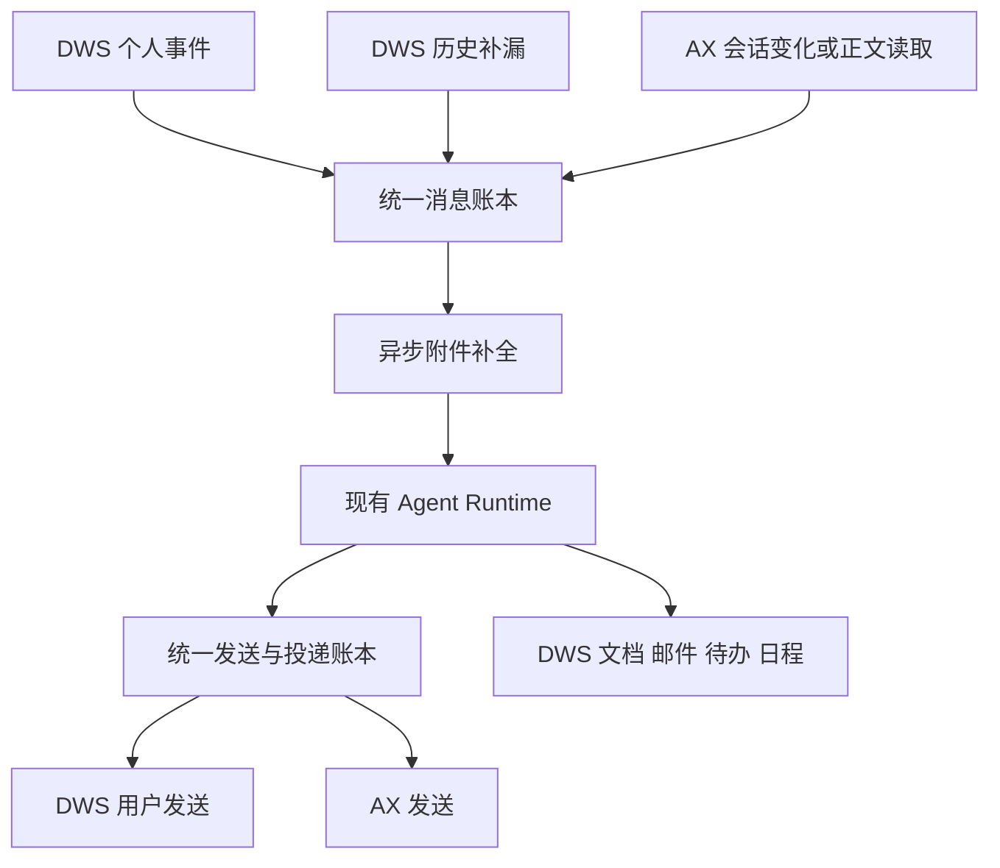

# Bridge 架构草案

总体架构与后续方向。2026-11-11 已实现 DWS 历史轮询、HTTP 事件游标、SQLite 发送账本和附件下载；Stream 入站/AX 尚未集成。当前实现与架构完整愿景分别记录，见 [运行手册](15-service-runbook.md)。

当前实施顺序以 [路线清单](13-roadmap-and-backlog.md) 为准。图中 AX 为条件选项；DWS 全部满足时不实现、不部署 AX。用户身份与 bot 的会话覆盖分别验证。

## 数据流

## 回退顺序

接收：官方个人事件 → 官方历史查询补漏 → AX 变化触发官方查询 → 必要时 AX 正文读取。轮询属于有延迟的补充路径，不能冒充实时推送。

媒体：官方消息资源下载 → 明确客户端资源可用后通过 UI 下载 → 仅在原图无法获取且任务允许时用截图，并标记 screenshot，不能假称原文件。

发送：同一用户身份下官方发送优先。只有明确未发送且回退条件满足才转 AX；传输超时或回执不明必须进入 outcome_unknown 对账。权限拒绝与技术故障分开，不将权限拒绝自动解释为允许界面替代。

## 身份与能力记录

主键建议 profileIdentity + conversationId；记录用户/机器人身份，群类别，客户端与 CLI 版本、测试时间。逐项维护 realtime、history、text-send、image-download、file-download、media-send 的 verified/partial/failed/unverified 状态。

显示名不能当稳定主键。AX 发现的名称与 DWS 会话 ID 必须唯一匹配；重名不猜。旧 aic测试群已由 UI 确认为内部群；当前新群已核实 INTERNAL_GROUP，稳定 ID 仅存本机配置。

## 建议消息模型

- bridge_event_id：本地唯一事件。
- source：dws_event / dws_history / ax。
- account、organization、conversation_id：路由身份。
- native_message_id：有则优先去重，无则保留 AX 临时标识及匹配置信度。
- sender、from_self、mentioned_me、message_time、observed_at。
- content_parts：按顺序保留文字、图片、文件、引用。
- attachments：original/screenshot、下载与解析状态、真实落盘路径、文件摘要。
- completeness：完整、部分、未知，及具体缺失原因。

不要只用正文哈希去重，用户可能连续发送相同文本。官方与 AX 双源匹配须结合会话、发送人、时间和顺序；低置信度不合并。

## 投递与可靠性

状态建议 accepted → executing → submitted → confirmed，另有 failed 与 outcome_unknown。两个发送后端共用一个幂等键。官方 task ID、message ID 或客户端气泡均保留证据级别。

接收先持久化再确认/分发；重连后以重叠时间窗补读并去重。每个会话保存水位、缺口、上次真实事件时间；无消息不等于健康。检测到历史新增但事件缺失时记录覆盖异常。

一个桌面 UI 同时只执行一个操作；媒体下载和 OCR 不持有 UI 锁。DWS 常驻进程持续消费 stdout/stderr，按 ready marker 区分进程启动与订阅就绪。进程重启、事件重放、官方索引延迟都应独立记录。

## 第一版边界

先完成指定群与专用私聊的文本事件、历史、用户发送和附件下载/回传；其他媒体及外部会话按矩阵逐项验收。只在官方路线存在已证实的必要缺口时增加 AX；暂不实施全组织监听、自动群管理、通话、实时视频会议或全产品 GUI 自动化。
