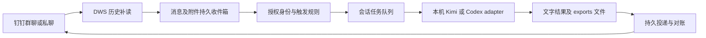

# 钉钉任务入口与本地 Agent 接入验收

更新：2026-11-11。用户要的是把钉钉变成本机 Agent 的工作入口：在私聊或群里交办任务、补充信息和附件，Agent 实际操作工具，持续使用该会话上下文，将结果和文件交回原会话。调研、HTTP 接口、成功发一条消息都只是其中一部分。

**当前已用veil客户端→liev DWS的两账号完成原群与私聊UI闭环。**文字、CSV附件输入、Kimi执行、多轮记忆、3个TXT回传下载打开通过，详见[docs/27](27-two-account-ui-acceptance.md)。下方首轮单人数据保留作历史；Codex真实请求超时，尚未通过。

## 用户的完整目标

| 层次 | 应具备的行为 | 当前实现 |
|---|---|---|
| 钉钉会话 | 群聊、私聊收发；身份和回复目标正确 | DWS 普通账号传输，group/direct 路由；现场启用liev原群与veil私聊 |
| Agent 会话 | 多轮上下文、排队、取消、重新开始、恢复 | 会话独立 SQLite 任务队列和精确原生 session ID；每会话串行 |
| 任务执行 | 使用真实工具完成文件、分析、开发等工作 | Kimi 本地工具实际执行；每个会话拥有工作区和交付目录 |
| 文件交付 | 原件下载、引用附件、生成文件、回传校验 | 输入摘要校验与复制；exports/ 文件检查、staging、投递对账 |
| 操作反馈 | 已接收、执行状态、追问、结果、失败 | 接收回执、status、最终回复/补充问题、失败/重启说明；工具级进度和交互审批待实现 |
| 组织办公 | 文档、日程、待办、会议、邮件等 | DWS 代表能力此前分别实测；尚未接成 Kimi 可受控调用的全套办公工具 |
| 通用性 | 换账号、会话、runtime 不重做 IM 层 | bridge 与 gateway/runtime 分层；原生会话不会被另一个 runtime 静默接管 |

“通用”意味着可替换执行引擎，同时必须有可工作的具体接入。用户不需要再替开发者指定一个 runtime 才能推进。本轮选择已能完成真实请求的 Kimi。

## 工作路径



桥接层保持 CLI/HTTP 公共契约。新增 `agent_gateway.py` 负责触发、任务、原生会话和回复；`agent_runtime.py` 封装本地 CLI。回复目标由宿主绑定的路由确定，模型不能通过返回 JSON 更改群或收件人。自动回复不是 DWS 传输层的隐式行为。

每个账号、profile、会话类型和稳定会话 ID 形成独立状态目录。当前一个 gateway 进程服务一个配置会话；多个路由可分别运行 gateway，但agent_ctl.py支持--config分别管理PID/日志，尚无自动发现后启用的多会话管理器。群里目前共享一个会话上下文，未实现按群成员或引用线程细分。

## 当前如何使用

veil可在原测试群向liev自动化发送：

```text
/agent 请生成一份项目检查清单，保存为 exports/checklist.md 并发回。
/agent 继续上一轮，把清单改成中文表格。
/agent status
/agent cancel
/agent new
```

处理已有附件：引用那条文件消息，在引用回复里写 `/agent 请读取这个附件，……`。liev自己的任何消息不启动任务；veil在私聊单独发附件会触发处理，随后文字是另一条任务。授权群成员须使用 `/agent ` 前缀；授权私聊对端可直接发任务。其余发送者不执行；`[Agent]` 回复不触发新任务。

`status` 返回任务与投递状态；`cancel` 停止正在执行的本地 CLI，若没有运行任务则取消最早等待任务（包括附件下载等待）；取消不能撤销工具已产生的操作。`new` 按队列顺序切到新的工作区和原生会话，不删除旧记录。如果附件持续下载失败，先取消该等待任务，避免阻塞后续任务。

这是 gateway 新建和持有的 Kimi 会话，不是接管当前 Codex 桌面聊天。通用收件箱的本人过滤保持原样；历史owner-command模式用于单人测试；当前allowSelfCommands=false，已切换为授权veil非自身任务与liev回复。

## 首轮已运行的真实验收

环境：隔离 DWS v1.0.67，Kimi Code 2.1.1，原内部单人群；未邀请成员、未新增组织或私聊路由。

| 验收 | 实际结果 |
|---|---|
| 第一轮引用 TXT | 已下载原文件并校验；复制到任务 inputs/；Kimi 实际调用工具读取 |
| 第一轮任务 | 生成 dingtalk-agent-report.txt，含原文件 DAB-FILE-001 摘要、中英文校验信息及代号青竹731 |
| 第一轮回传 | 接收回执、结果文本、报告文件共 3 条 confirmed |
| 回传原件 | 通过原消息 ID 重新下载文件，与生成/暂存件 SHA256 一致 |
| 第二轮记忆 | 提问不含代号；同一原生会话答出青竹731；该轮日志无工具调用 |
| 第二轮回传 | 接收回执和回答共 2 条 confirmed |
| 服务重启 | 两任务记录、原生 session、执行日志、5 条投递均保持一致，没有重做或重发 |
| 现场账本 | 本轮新增 2 条任务命令与 5 条回复；此前 18 条变为 25 条，历史快照的 18 不再代表当前总数 |

[脱敏验收证据](../evidence/2026-11-11/local-agent-loop.json)、[运行引擎探针](../evidence/2026-11-11/local-runtime-preflight.json)、[回归结果](../evidence/2026-11-11/local-agent-unit-tests.json)。两个实际任务各有私有 JSONL 执行日志，不把模型推理、工具原文、账号 ID 或令牌转发到群里。首轮 51 项自动化回归还覆盖群/私聊隔离、丢失 HTTP 回包复用同一发送键、重启不重做、取消等待、目录准备失败、文件及 exports 符号链接越界。

新增六场景及71项回归、当前44条事件见[docs/25](25-official-boundary-and-scenarios.md)。本页上表保留首轮25条快照。

## Runtime 选择和实测差异

Kimi 使用 `--prompt`、`--output-format stream-json`，保存 `session.resume_hint` 返回的 ID，后续用 `--session` 精确恢复。本机确认最后事件后可仍有进程句柄存活，adapter 在收到最终事件后只终止自己启动的 CLI 进程组。首次试用 `--prompt --yolo` 被 CLI 拒绝，已经按当前契约移除冲突参数。[Kimi 官方命令文档](https://moonshotai.github.io/kimi-code/en/reference/kimi-command.html)

**Kimi 的非交互 prompt 模式使用 auto 权限，它不是操作系统沙箱。**当前仅允许已核验veil，群显式命令、私聊普通任务和独立会话工作区；提示词限制读写范围，宿主强制限制可回传文件，但这些不构成对全部 shell 操作的系统隔离。现有指定两账号部署可承接veil的任务，扩大到不可信成员前需要隔离执行环境或 ACP 工具审批，不能仅添加 sender 白名单便宣称安全多租户。

Codex CLI 0.164.0 已登录。以受限工作区、JSON 输出、结构化结果分别尝试默认请求和本机配置模型，请求在 120 秒、90 秒上限内均未产出答案，出现连接重试超时。adapter 已支持 `exec`、精确 `resume`、原生 session、图片参数和结果 schema，但这只是实现状态。没有使用 `--last` 混接其他聊天，也没有改动用户全局配置。[Codex 非交互文档](https://developers.openai.com/codex/noninteractive)

后续要支持工具审批、执行中补充信息和结构化进度，优先将 adapter 升级为 Codex app-server / Kimi ACP；任务、附件与投递层可以继续复用。当前 CLI 路径先提供已验证的本地执行闭环。

## 从现有实现采用什么

| 参考 | 采用的机制 | 本项目的差异 |
|---|---|---|
| 本地 wecom-bridge，提交 1ee7f8c | 稳定会话定位、消息去重、附件与发送账本、未知结果对账 | 其 AX 是企微传输实现；钉钉先走 DWS，不复制界面元素或账号数据 |
| 本地 wecom-agent-gateway，提交 8f7e2416 | runtime adapter 分层、Codex 原生会话、ACP 和媒体边界 | 它的 Bot-only 约束不覆盖本项目普通账号路线；未修改该项目 |
| OpenClaw Slack 插件 | 将接入授权、会话线程、接收反馈、附件、审批拆成独立机制 | 当前只实现文字回执与状态查询，尚无原生卡片审批或增量预览 |
| OpenClaw Telegram 插件 | 将 topic/会话绑定持久化，后续消息恢复对应执行会话 | 当前按钉钉 conversation 隔离，尚未移植 topic/线程模型 |

参考不是照搬平台 API。Slack 的 App/Socket Mode 和 Telegram 的 topic 行为不能直接证明 DWS 的接收范围；应复用上层产品行为和恢复设计。[Slack 官方插件文档](https://docs.openclaw.ai/channels/slack)、[Telegram 会话文档](https://docs.openclaw.ai/channels/telegram/threads-and-sessions)。本地仓库的完整固定版本见 [docs/21](21-existing-runtime-integration.md)。

## 启停与排错

在项目根目录执行；当前传输及两个gateway均已启动，未安装开机自启：

```bash
python3 scripts/service_ctl.py status
python3 scripts/agent_ctl.py status
python3 scripts/agent_ctl.py --config local/agent-direct-config.json status
# 需要停止自动执行时：
python3 scripts/agent_ctl.py stop
# 重新启用已有配置：
python3 scripts/service_ctl.py start
python3 scripts/agent_ctl.py start
```

群运行配置 `local/agent-config.json`，私聊配置 `local/agent-direct-config.json`，公开模板 [config.agent.example.json](../config.agent.example.json)。真实值只留 local/，不复制其他项目账号数据。任务、队列、原生 session 和日志保存在 `local/agents/<scope摘要>/`，回复文件在 `local/outbox/agent/`。不要删除这些状态后重放任务。更换 runtime 不能直接覆盖原配置并沿用旧 session；当前会拒绝该操作，应另建明确部署并规划会话迁移。

程序异常重启时，正在执行的任务标为 interrupted 并发出说明，不自动再调用可能有副作用的工具。已提交但结果不明的消息沿用原发送键查询对账，不换键重发。默认每轮最长 600 秒。执行成功而投递失败会保留任务结果和 outbox，排错时分别看任务与投递状态。

只核验已有验收记录，不再次给群发消息：

```bash
python3 scripts/accept_local_agent.py
python3 -m unittest discover -s tests -v
python3 scripts/verify_handoff.py
```

复测重启需在无运行任务时依次执行 `accept_local_agent.py --snapshot`、`agent_ctl.py stop`、`agent_ctl.py start`，等待至少一个消费周期，再执行 `accept_local_agent.py --compare-restart`。共享证据只在核对后用 `--compare-restart --write-evidence` 更新。此脚本只检查上述两条合成任务，后续用户任务不属于这两条样本。

## 仍需完成的产品关卡

指定veil与liev已完成真实私聊及两人群UI，外部会话和任意第三人仍未验收，不外推全部会话覆盖。当前历史轮询有索引延迟，尚无完整事件实时收取验收。原生语音/视频发送仍缺，音视频文件可以作为附件传输，理解/转写取决于另行配置的处理工具。

复杂任务还需要项目工作区绑定、受控办公工具、审批与执行中追问、任务级进度、会话/线程策略、保留期和长期运行验收。当前可以实际处理会话工作区内的任务与文件；不承诺所有业务任务、所有文件格式、任意本地仓库或办公权限都已接通。接入这些能力应继续扩展现有 gateway，而非重做传输层或停在文档调研。

## 2026-11-12 Codex超时只读复核
原configured请求有turn.started及四次responses_retry采样超时告警，没有turn.completed；这是响应流失败证据，不足以推断具体网络、授权或模型根因。当前本机配置为内置OpenAI、无显式endpoint覆盖/代理环境变量，但这是后续快照，不能反推原请求环境。本轮不重复模型请求、不改配置/凭据；Kimi仍满足任选本地执行器。脱敏记录见[codex-timeout-review.json](../evidence/2026-11-12/codex-timeout-review.json)。官方[高级配置](https://learn.chatgpt.com/docs/config-file/config-advanced)分别说明provider端点与重试参数；不将一般重试参数视为本例修复证据。
