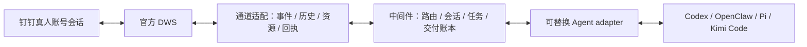

# 钉钉 ↔ 主流 Agent 中间件

E132（2026-11-16）同步现有模块与已登记验收。默认官方DWS真人账号，产品独立于组织和runtime；当前版本/部署/剩余工作统一见[总览](../102-user-requirements-and-roadmap.md)。CEO提供任务/交付/runtime契约参考，Qwen提供通道事务参考，均未整包移植。

## 身份决策

默认消息主体是 **DWS 显式 profile 授权的真人账号**。Agent 是执行器，不能把 runtime 的名称、模型选择或机器人 appId 变成发言身份。当前测试的 liev/veil 仅为配置实例，产品不绑定人名或组织。

bot/数字员工不是自动替代或故障回退。DWS 失败不自动切 bot、AX 或另一账号发送。普通账号的操作依然受官方开放能力、组织授权、会话成员关系和资源权限共同限制；“真人在客户端可见”不等于 DWS 已开放同一 API。

对每个具体身份/会话分别记录：发现会话、历史、事件、文字发送、引用、文件上传/下载、原生媒体、办公资源。内部群、外部群、含外部成员群、跨组织私聊不能混为一个通过项。

[官方仓库 #937](https://github.com/DingTalk-Real-AI/dingtalk-workspace-cli/issues/937)E092核对时 open（不是本轮重新查询的状态）：原报告存在外部群历史可读而个人事件失败的对照；后续评论群类型未核实，不能泛化为所有当前外部群都失败或已修复。只有某目标历史确实可读时，才可选 history 补读；不得伪称它是实时 Stream。跨组织/客户场景继续按原矩阵待验，不套用企业微信、Slack、Telegram 或飞书的权限结论。

## 分层与现有代码位置

| 层 | 当前文件 | 复用来源/边界 |
|---|---|---|
| 官方调用和暂停 | `dws_access.py`、`official_proxy.py` | 官方 DWS；不复制认证、token 或 OAuth 状态机 |
| 收发与路由 | `core.py`、`composition.py`、`stream.py`、`routing.py` | 优先对照 Qwen DWS client/stream；保留已验的固定身份、持久续页及未知发送对账 |
| 中立消息和原件 | `message_model.py`、`consumer.py` | 有序 parts、quote、sender、原件路径/大小/SHA；不能因参考实现只接 text 就丢附件 |
| 会话/任务/交付 | `agent_gateway.py`、既有 SQLite 账本 | Qwen 队列/会话、CEO 文件回执与恢复设计；保持既有任务和终态 |
| 本地执行 | `agent_runtime.py`、`runtime_guard.py` | Kimi/Codex/Pi已实现并各有真实范围；OpenClaw在openclaw_runtime.py实现、随E134部署，但未配置绑定/真实模型验收；原生协议不进入DWS层 |
| 对外工具面 | CLI、HTTP、`consume.py` | 任意宿主可独立消费；不要求安装某一个 Agent 框架 |

E133的composition已于E134随2467fe2部署，两路API/history/官方逐原件已验：输入字面文字及有序原图摘要，暂存后通过官方Markdown一次发送，统一原key对账；不调用模型，不承诺原生image卡片或客户端原件获取。Kimi服务拒绝只影响绑定的可选gateway任务，不阻塞这层开发。

以上是现有模块映射，不为整理目录搬动产品文件、数据库或运行配置。短期保持当前 Python 传输/账本，通过窄接缝引入采用的组件；没有依赖/测试收益依据时不整体改写语言或 fork 一个大型宿主。

## 必须统一的语义

- 身份键与会话键分离：固定 DWS profile/账号、conversation、可选 thread；runtime session 另存绑定，不能用昵称或默认登录账号猜目标。
- 单一执行归属：同一路消息只由一个任务宿主运行。独立中间件可拥有任务；OpenClaw 原生插件模式由 OpenClaw 拥有 Agent turn，中间件只提供通道。两者不能同时消费同一路而重复执行。
- 收消息、触发任务分离：群普通消息可收，但只按明确策略触发；自消息过滤不通过屏蔽整段历史实现。
- 任务完成与投递完成分离：模型声明“已发送”不是回执；submitted、confirmed、outcome_unknown、rejected/failed 保持可区分。只在原 key/原任务上对账。
- 文件是原件交付：明确输入能力、物化路径、摘要和保留时间；发送前固定字节，输出由宿主校验并回原会话。图片/文件与语音条/独立视频类型分开。
- 能力按证据声明：支持文字不推断支持任意附件；不支持的能力显式报告，不能用文件名占位假装模型已读。
- 通道权限与 Agent 工具权限分离：DWS 真人账号有权限，不等于聊天中的任意人能调用该账号全部办公能力。触发白名单和受管工具入口继续有效。

## 当前部署与后续接缝

现场产品为 E150 的 `0e151fb`，两路原有执行器绑定保留。E151 验证真实语音入站及既有双 PNG 消息逐图保存。E131 群双图任务因 Kimi 403 失败。DWS 准入与模型服务访问分别核验。[媒体实测](../151-native-voice-and-image-saving.md) · [运行器接入表](agent-integration-map.md)

C01文件摘要、C02发送事实、C03能力/终态、C04兼容性与C06环境已采用并部署；Qwen接纳/完成与inbox/job/outbox事务对照于E124完成。已有等价实现只映射，不重新实现；C05租约仅有多宿主实际需要时引入，不能把当前flock视为缺陷。具体[采用账](../references/adoption-plan.md)。

现场限原授权测试群及私聊。E141 已删除聊天调度。系统钥匙串永久根因及无效 refresh 恢复仍未知；原 24 小时观察的采样及错误恢复结论见[总览](../102-user-requirements-and-roadmap.md)。尚缺普通账号原生语音出站、独立 video 协议与任意多文件单气泡。
